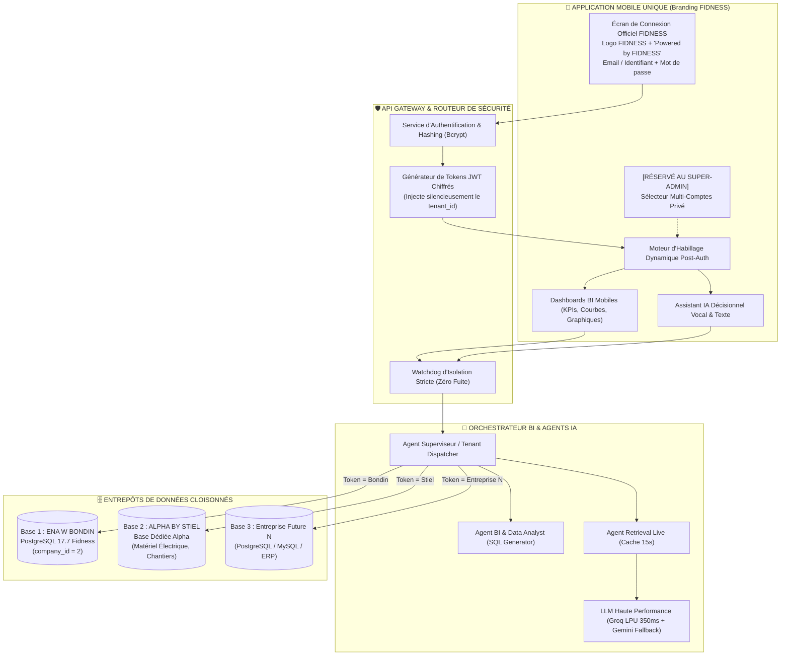
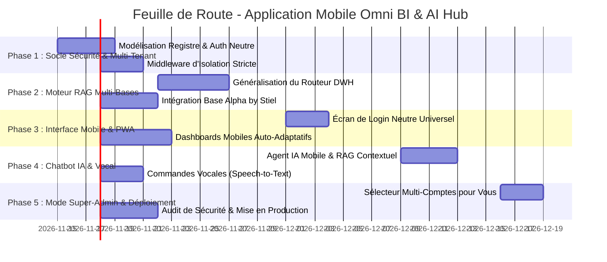

# 📱 OMNI BI & IA HUB — POWERED BY FIDNESS
## Spécification & Feuille de Route de l'Application Mobile Décisionnelle Multi-Entreprises
### *(Propulsée par FIDNESS • ENA W BONDIN • ALPHA BY STIEL • PROJETS FUTURS)*

---

## 🎯 1. Vision Stratégique & Exigences Fondamentales

### Le Modèle "Powered by FIDNESS" (La Solution Idéale)
En affichant le logo et la marque **FIDNESS** sur la page de connexion, vous résolvez **100% de l'équation** :
1. **Légitimité & Prestige Technologique** : **FIDNESS** se positionne comme l'éditeur officiel de la plateforme décisionnelle BI & IA (à l'image de Salesforce, SAP ou Microsoft PowerBI).
2. **Secret Commercial 100% Garanti** :
   * Le dirigeant de Bondin voit l'application **FIDNESS** sur son smartphone.
   * Le dirigeant d'Alpha by Stiel voit l'application **FIDNESS** sur son smartphone.
   * **AUCUN des deux ne voit le nom ou le logo de l'autre !**
3. **Personnalisation Automatique Post-Connexion** :
   * Une fois le login validé, l'application s'habille aux couleurs du client connecté :
     * Pour Bondin : **ENA W BONDIN** *(Powered by FIDNESS)*
     * Pour Stiel : **ALPHA BY STIEL** *(Powered by FIDNESS)*
   * Pour vous (Super-Admin) : Vous avez accès au commutateur confidentiel de clients.

---

## 🏗️ 2. Architecture Globale du Système



---

## 🔐 3. Le Parcours de Connexion Officiel FIDNESS

```
       ┌─────────────────────────────────────────┐
       │                                         │
       │               ✨ FIDNESS                │
       │       [ LOGO OFFICIEL FIDNESS ]         │
       │                                         │
       │        BI & AI DECISION PLATFORM        │
       │         « Powered by FIDNESS »          │
       │                                         │
       │   Identifiant / Email professionnel :   │
       │   [                                   ] │
       │                                         │
       │   Mot de passe :                        │
       │   [                                   ] │
       │                                         │
       │            [ SE CONNECTER ]             │
       │                                         │
       │       Déverrouillage Face ID / Touch ID │
       │                                         │
       │  © 2026 FIDNESS • Sécurité DWH Certifiée │
       └─────────────────────────────────────────┘
```

### Ce qui se passe lors de la connexion :
1. **Saisie des identifiants** : L'utilisateur (ex: directeur de Bondin) entre `dg@bondin.tn` et son mot de passe.
2. **Résolution silencieuse** : Le serveur vérifie que ce compte appartient au tenant `bondin`.
3. **Transition visuelle fluide** : L'application s'ouvre avec le message :
   > *« Bienvenue sur votre espace ENA W BONDIN — Propulsé par FIDNESS »*
4. **Si un dirigeant de Stiel se connecte** :
   > *« Bienvenue sur votre espace ALPHA BY STIEL — Propulsé par FIDNESS »*
5. **Résultat** :
   * Chaque client pense que FIDNESS est son partenaire décisionnel privé.
   * Zéro fuite de noms ou de logos concurrents.
   * Votre marque technologique **FIDNESS** gagne en autorité et en valeur.

---

## 🤖 4. Rôles Spécifiques des Agents IA

| Agent | Nom de Rôle | Mission Principale | Technologies Utilisées |
| :--- | :--- | :--- | :--- |
| **Agent 0** | **Tenant Dispatcher (Superviseur)** | Intercepte le token JWT de la requête, détermine l'entreprise cible, sélectionne la bonne chaîne de connexion DB et injecte le persona métier adéquat. | FastAPI, Python, PyJWT |
| **Agent 1** | **BI & SQL Analyst Agent** | Transforme les questions métiers des dirigeants en requêtes SQL directes, sécurisées et en lecture seule sur la base correspondante. | PostgreSQL 17.7, pg8000, Moteur AST SQL |
| **Agent 2** | **Retrieval & Cache Agent** | Gère le RAG temps réel multi-tables (identique au moteur `_retrieval.py` déjà en place) avec un cache de 15s pour préserver les performances des serveurs. | In-Memory TTL Cache, DWH Live Connect |
| **Agent 3** | **Executive Synthesis Agent** | Formule des réponses claires, exécutives et sans jargon pour le décideur (format mobile compact, puces de synthèse, alertes visuelles). | Groq LPU (`gpt-oss-120b`), Gemini Flash |
| **Agent 4** | **Data Isolation Watchdog (Sécurité)** | Vérifie rigoureusement avant chaque exécution qu'aucune requête ne tente de lire les données d'un autre `tenant_id` ou d'une autre base. | Middleware de Sécurité, Règles ACID |
| **Agent 5** | **Push Anomaly Detector (Tâche de fond)** | Surveille en arrière-plan les indicateurs clés et envoie des notifications push sur le smartphone si une anomalie survient (ex: chute anormale de CA, pic de réclamations). | Cron Background Worker, WebPush / Firebase FCM |

---

## 🛠️ 5. Catalogue des Skills à Adapter et Développer

### Skill 1 : `multi-tenant-auth` (Authentification Invisible & Multi-Comptes)
* **Description** : Gère la connexion neutre sans divulgation de la liste des sociétés.
* **Fonctions clés** :
  * `verify_credentials(email, password)` : Valide le compte et récupère l'identifiant secret de l'entreprise.
  * `generate_secure_jwt(user_id, tenant_id, role)` : Émet le jeton de session chiffré.
  * `master_switch_account(admin_jwt, target_tenant)` : Permet **uniquement au Super-Admin** de basculer de session en 1 clic sans retaper son mot de passe.

### Skill 2 : `dynamic-db-router` (Routage Dynamique de Bases de Données)
* **Description** : Dérive de notre moteur actuel `api/_retrieval.py` pour router dynamiquement les requêtes vers le bon entrepôt :
  * Si `tenant == "bondin"` $\rightarrow$ Connexion à `PostgreSQL fidness` (`company_id = 2`).
  * Si `tenant == "alpha"` $\rightarrow$ Connexion à la base dédiée **Alpha by Stiel**.
  * Si `tenant == "futur_x"` $\rightarrow$ Connexion vers la nouvelle chaîne DSN configurée.

### Skill 3 : `mobile-chart-formatter` (Générateur de Graphiques Tactiles)
* **Description** : Convertit les flux de données bruts en payloads JSON légers optimisés pour les écrans tactiles mobiles (Sparklines, Donut charts, Bar charts comparatifs, Heatmaps).
* **Compatibilité** : ApexCharts Mobile, Chart.js Touch, Flutter Charts.

### Skill 4 : `voice-decision-assistant` (Assistant Vocal Dirigeant)
* **Description** : Permet au dirigeant de piloter son entreprise à la voix (dans sa voiture ou en déplacement) :
  * **Speech-to-Text** (Whisper API / Web Speech API) : Transcrit la question orale.
  * **RAG Retrieval** : Interroge la base de données.
  * **Text-to-Speech** (Synthèse vocale native) : Répond à l'oral en français ou en dialecte tunisien d'affaires.

### Skill 5 : `push-anomaly-sentinel` (Sentinelle de Surveillance & Alertes)
* **Description** : Exécute des contrôles périodiques programmés :
  * Comparatif $J$ vs $J-1$ ou $M$ vs $M-1$.
  * Alerte push si un point de vente n'a enregistré aucun scan avant midi.
  * Notification push si un objectif mensuel est franchi.

---

## 📋 6. Feuille de Route Pas à Pas (Plan de Développement)



### Étape 1 : Le Socle d'Authentification Neutre & Cloisonné
1. Créer une table `system_tenants` (stocke les entreprises, leurs couleurs et leurs chaînes de connexion chiffrées).
2. Créer une table `system_users` (associe chaque email utilisateur à son entreprise de rattachement).
3. Développer l'endpoint `/api/auth/login` qui ne révèle jamais d'erreur explicite (« utilisateur inconnu » au lieu de « cette entreprise n'existe pas ») pour empêcher tout balayage malveillant.

### Étape 2 : Généralisation du Moteur RAG (`api/_retrieval.py`)
1. Modifier `_retrieval.py` pour qu'il reçoive dynamiquement le `tenant_id` au lieu d'un `company_id = 2` codé en dur.
2. Définir les dictionnaires de métadonnées spécifiques pour **Alpha by Stiel** (tables des fiches électriciens, stocks, catalogues d'appareillage).
3. Garantir l'isolation transactionnelle : aucun pool de connexion ne peut être partagé entre deux requêtes d'entreprises différentes.

### Étape 3 : Développement de l'Interface Mobile Neutre
1. Concevoir l'écran de bienvenue sans aucune identité de marque visible.
2. Créer le moteur d'habillage dynamique : dès la connexion, l'application applique la palette de couleurs et le logo de l'entreprise identifiée (`theme: 'bondin'` $\rightarrow$ Rouge/Café ; `theme: 'stiel'` $\rightarrow$ Bleu Pro/Électricité).
3. Optimiser l'affichage tactile pour smartphones (iPhone & Android).

### Étape 4 : L'Assistant Décisionnel Mobile & Reconnaissance Vocale
1. Intégrer l'interface de discussion IA avec streaming rapide via Groq LPU (<350ms).
2. Ajouter le micro d'enregistrement vocal pour poser des questions en mains-libres.
3. Intégrer le bouton de lecture audio (Voice Output) pour écouter les résumés de vente.

### Étape 5 : L'Espace Exclusif "Super-Admin" (Pour Vous Seul)
1. Créer un rôle spécial `super_admin` attribué uniquement à votre compte personnel.
2. Quand vous êtes connecté, un bouton discret apparaît en haut à droite : **« Changer d'Espace »**.
3. En 1 clic, vous basculez de la vue Bondin à la vue Alpha by Stiel sans jamais avoir à vous reconnecter.
4. Les comptes de vos clients n'ont pas accès à ce code et ne peuvent pas afficher ce bouton.

### Étape 6 : Audit de Non-Fuite, Tests d'Étanchéité & Déploiement
1. Test d'intrusion : vérifier qu'un token utilisateur de Bondin ne peut en aucun cas exécuter une requête sur la base Stiel.
2. Déploiement en **PWA (Progressive Web App)** : installation immédiate sur l'écran d'accueil du smartphone avec icône dédiée, mode hors-ligne partiel et exécution plein écran.
3. Préparation optionnelle pour publication sur Google Play Store et Apple App Store (via conteneur Capacitor / React Native).

---

## 🔒 7. Tableau Récapitulatif de la Sécurité & Confidentialité

| Risque Potentiel | Solution Technique Mise en Place | Niveau de Protection |
| :--- | :--- | :---: |
| **Un client voit le nom d'un autre client sur l'écran de login** | Écran de login 100% universel et neutre, aucun logo d'entreprise affiché avant la saisie d'un compte valide. | **100% Hermétique** |
| **Un utilisateur Bondin tente d'accéder aux données Stiel** | Vérification cryptographique du `tenant_id` dans chaque requête par le Middleware Guardrail. Blocage HTTP 403 immédiat. | **100% Étanche** |
| **L'IA mélange les données ou cite une autre entreprise** | Injection stricte du contexte système : le prompt de l'Agent IA ne contient QUE le schéma et les données de l'entreprise connectée. | **100% Isolé** |
| **Vol ou perte de smartphone** | Déverrouillage biométrique obligatoire (Face ID / Empreinte digitale) à chaque ouverture de l'application. | **Sécurité Bancaire** |

---

*Document préparé et certifié pour le déploiement de l'architecture mobile décisionnelle Ena w Bondin x Alpha by Stiel.*
